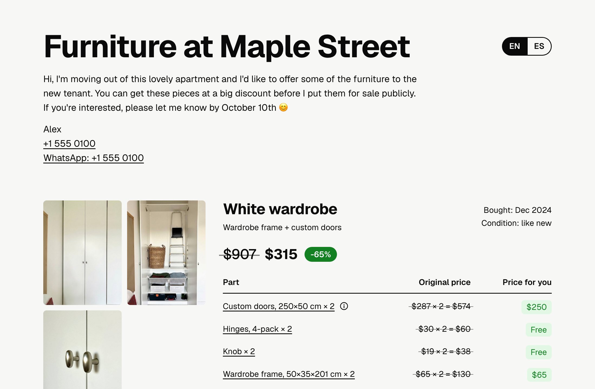

# Furniture sale

One-page website template for selling your furniture or other personal items. Your AI app asks you a few questions and fills in the page, and the layout adjusts automatically. [See an example](https://tumaranja.github.io/furniture-sale/).

<picture></picture>

## Make your own

1. Open your AI app (for example ChatGPT, Claude, Gemini, or Copilot).
2. Copy the long text from the box below (there's a copy button at its top right) and paste it into your AI app.

```text
I want to make a one-page website to sell my furniture or other things.

Template: https://raw.githubusercontent.com/tumaranja/furniture-sale/main/template.html
Rules:    https://raw.githubusercontent.com/tumaranja/furniture-sale/main/RULES.md
Example:  https://raw.githubusercontent.com/tumaranja/furniture-sale/main/example/data.json

Open all three. Use the template exactly as it is and follow the rules. The
example only shows the format: don't copy any of its content.
If you can't open the template, tell me and I'll paste or attach it. If you
can't open the rules or the example, go on with this message and the comment
in the template, which lists every field.

Always:
1. Change only the data block (and, for a new language, the labels block).
   Never touch the styles or the code.
2. Only use what I tell you. Leave out anything I don't give you; empty
   fields stay empty. Leave out "makeYourOwn".
3. Never invent photo file names. If you can't use a photo, tell me.
4. Ask me one topic at a time:
   - my first name, a title for the page, and the reply deadline
   - how I'd like to be contacted (phone, WhatsApp, Signal, Telegram, email,
     or nothing), reminding me the page may be forwarded
   - anyone else they can contact (optional)
   - languages and currency
   - for each item: what it is, when I bought it, condition, parts, price new
     per part, my price or discount, product links, flaws, and 1–3 photos

When you have everything, give me the complete page as a file named
index.html. Then help me publish it, step by step for a non-technical person, and be honest about
what you can do in this chat, today, on my plan:
1. If you can show the page and give me a public link right here, do it.
2. Tell me whether my photos made it into the page, and if not, exactly what
   to do so they show.
3. If you can't publish it, recommend the simplest free way that exists now to
   put a folder with the page (index.html) and its photos online. The photos
   go in the same folder as the page.
4. Ask me to open the link on my phone in a private window and check that the
   page and every photo load.
```

3. Your AI app will ask you questions. Answer them and add your photos, and it will create your page and help you put it online.
4. Whether your AI app can add your photos and put the page online depends on the app and your plan. If it's not possible on a free plan, you have these options:
   - **Use a paid plan** and publish in the AI app itself: ChatGPT (Canvas, shared as a chat link), Claude (Artifacts), Gemini (Canvas). These are the apps' built-in page previews that you can share. On free plans they usually can't include your own photos.
   - **Put it online yourself, for free:**
     1. Download your finished page from your AI app. It should be a file named `index.html`. If it isn't, write:<br>&nbsp;
        ```text
        Give me my finished page as a file named index.html that I can download.
        ```
     2. Make a new folder on your computer and move `index.html` into it.
     3. Save your photos into the same folder, with the exact file names your AI app used in the page.
     4. Go to [Netlify Drop](https://app.netlify.com/drop) and drag the whole folder onto the page. You get a link you can share.
     5. Make a free Netlify account, so the link doesn't expire after an hour.
   - **Advanced: GitHub Pages** (free and permanent, if you have a GitHub account):
     1. Make a new, empty public repository on GitHub for your page.
     2. Upload your finished `index.html` file and your photos to it (Add file → Upload files).
     3. Go to Settings → Pages, choose your main branch as the source, and save.
     4. After a minute your page is live at `https://<your-username>.github.io/<repository-name>/`.

## License

[Public domain](LICENSE). Use it for free, change it, share it. No credit needed.
